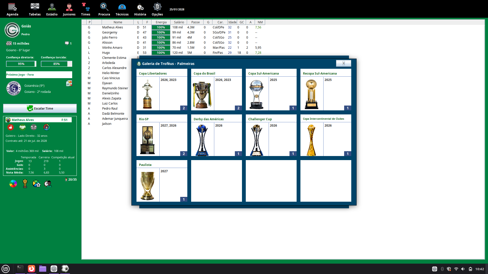

# Brasfoot no Linux

Execução do Brasfoot 2022–2023 diretamente em Java no Linux, sem Wine, com um
mod de carreira que adiciona o Mundial de Clubes de 32 times e a Copa
Intercontinental de Clubes.



*Captura de uma carreira em 2028: os títulos de 2026 aparecem junto aos demais
na galeria original do clube, com imagens, anos e contadores.*

## O que foi feito

| Área | Implementação |
| --- | --- |
| Linux | Extração do aplicativo Java contido no lançador Windows e execução direta com Java/Swing. |
| Mundial de Clubes | 32 clubes, oito grupos de quatro, oitavas até a final; primeira edição em 2025 e novas edições a cada quatro anos. |
| Classificação | Resultados gerados na carreira, vagas por confederação e campeões continentais de 2021 como classificados iniciais de 2025. |
| Intercontinental | A partir de 2024, substitui o Mundial anual, com seis campeões continentais e cinco jogos. |
| Taças | Mundial, Intercontinental, Copa África–Ásia–Pacífico, Derby das Américas e Challenger Cup. |
| Integração | Calendário, histórico, artilharia, galerias nativas e pontos nos rankings de clubes e técnicos, com detalhamento por competição. |
| Finanças | Premiações por participação e avanço, além de público e bilheteria calculados no estádio do mandante. |
| Carreira | Classificados, partidas, campeões e torneios em andamento persistidos no save do mod. |

O jogo usa seu motor original. Este repositório publica o código do patch e as
ferramentas de preparação, sem incluir o instalador, o JAR do Brasfoot ou saves.
O mod está em **beta**, com as limitações descritas abaixo.

## Instalação no Linux

### 1. Dependências

Você precisa de Linux com ambiente gráfico, **JDK 21** (incluindo `javac`),
Python 3.9 ou superior, Git e `7z` ou `7zz`. Não há dependências Python para
instalar com `pip`.

No Ubuntu 24.04 ou Linux Mint 22:

```sh
sudo apt update
sudo apt install git openjdk-21-jdk python3 p7zip-full
```

Confira se o Java e o compilador ativos são da versão 21:

```sh
java -version
javac -version
```

Ambiente utilizado no desenvolvimento: Linux Mint 22.3, OpenJDK 21 e Python 3.12.

### 2. Baixar o projeto e preparar o jogo

```sh
git clone https://github.com/pedro-grajau/brasfoot-linux.git
cd brasfoot-linux
python3 tools/prepare_linux.py --installer "$HOME/Downloads/brasfoot22-23.exe"
```

Forneça o caminho do **seu instalador original do Brasfoot 2022–2023**. Se ele
estiver na raiz do projeto com o nome `brasfoot22-23.exe`, basta executar:

```sh
python3 tools/prepare_linux.py
```

O script extrai o instalador sem executá-lo, identifica o aplicativo Java e
verifica a integridade dos arquivos extraídos. O build do mod aceita somente
a versão cujo JAR normalizado tem este SHA-256:

```text
7028a8b5f08c02fb10690fdb8c1cc7e2ec4b14f5b3aafe22db78626110794aeb
```

Outra edição do jogo pode ter classes e métodos diferentes. Renomear seu
instalador não torna essa edição compatível. Os requisitos de registro do
jogo original continuam aplicáveis.

### 3. Compilar o mod

```sh
python3 tools/build_mod.py
```

O build valida as regras e imagens, compila o código do mod, aplica os pontos
de integração e prepara uma instalação separada. As bibliotecas necessárias
vêm do próprio instalador; não é necessário baixar um decompilador.

### 4. Jogar

```sh
./run-brasfoot-mod.sh
```

Para acompanhar toda a transição, inicie uma carreira em **2022**, com as
**competições internacionais habilitadas**. A Intercontinental começa em 2024
e o Mundial de 32 clubes em 2025.

Para executar a versão original extraída, sem o mod:

```sh
./run-brasfoot.sh
```

## Arquivos locais e saves

| Caminho | Conteúdo |
| --- | --- |
| `artifacts/original/` | Arquivos extraídos do instalador. |
| `artifacts/linux/brasfoot.jar` | Aplicativo Java original normalizado. |
| `artifacts/linux/brasfoot-competitions.jar` | Aplicativo com o patch integrado. |
| `runtime/competitions/game/` | Instalação separada usada pelo mod. |
| `runtime/competitions/game/sav/` | Pasta padrão de saves dessa instalação. |
| `runtime/competitions/preferences/` | Preferências Java isoladas do mod. |
| `analysis/` | Relatórios de preparação, integridade e build gerados localmente. |

Esses diretórios não são enviados ao Git. Se você escolher outra pasta de
saves nas opções do jogo, essa configuração prevalece. Guarde uma cópia dos
seus saves antes de atualizar.

Para atualizar, salve e feche o jogo, depois execute:

```sh
git pull --ff-only
python3 tools/build_mod.py
./run-brasfoot-mod.sh
```

Carreiras existentes do beta recebem os ajustes de histórico e ranking ao
carregar, sem repetir os pagamentos já registrados. A migração completa de
qualquer save antigo da versão original não foi validada. Saves do mod devem
ser abertos com o JAR do mod.

## Testes

Após preparar e compilar:

```sh
python3 tools/validate_competitions.py
python3 tools/test_mod.py --without-save
```

A suíte usa cenários controlados para verificar classificação, formato dos
torneios, persistência, troféus, rankings, premiações e bilheteria. Para incluir
os cenários que carregam um save real, informe uma cópia local:

```sh
python3 tools/test_mod.py --save /caminho/para/seu-save.s22
```

O save é lido para testes em memória e seu hash é conferido ao final. A execução
completa de referência usou uma carreira com 668 clubes e passou 530
verificações. A quantidade depende dos cenários disponíveis; o teste sem save
omite os casos que exigem uma carreira real. Esses testes não substituem a
validação manual de todas as telas e temporadas.

## Como o port funciona

O executável Windows contém um aplicativo Java/Swing dentro de um lançador
Launch4j. As ferramentas recuperam esse aplicativo e iniciam sua classe de
entrada diretamente no Linux. Não houve reescrita completa do motor do jogo.

O mod adiciona suas próprias classes e aplica 18 pontos de integração em dez
classes originais, com verificação da versão de entrada. O código do motor
original e os arquivos de análise decompilados não são publicados aqui.

```text
mod/src/mod/           Lógica das competições, finanças e integração visual
mod/test/mod/          Testes de integração
mod/assets/trophies/   PNGs preparados e registro de preparação
patches/              Regras, classificados iniciais, taças e premiações
tools/               Extração, validação, compilação e testes
docs/                Explicação técnica e captura do jogo
```

## Regras e limites do beta

- A edição de 2025 reserva vagas para Chelsea, Palmeiras, Al-Hilal, Al Ahly e
  Monterrey, campeões continentais de 2021. As vagas restantes usam os
  resultados e o histórico disponível da carreira. Não há campeão da OFC de
  2021 como semente, pois a edição continental foi cancelada.
- As vagas são distribuídas entre UEFA (12), CONMEBOL (6), CAF (4), AFC (4),
  Concacaf (4), OFC (1) e país-sede (1). As regras detalhadas de limites por
  país, sorteio e desempate estão na documentação.
- O ranking de classificação usa as informações registradas pelo jogo. Não
  reproduz integralmente o ranking histórico real da FIFA quando faltam dados.
- O calendário procura datas livres nas janelas dos torneios. Não implementa
  uma pausa global de todas as ligas nem garante 72 horas em relação a todos
  os outros campeonatos.
- A bilheteria usa o estádio do mandante e o cálculo nativo do jogo, uma
  adaptação à estrutura do Brasfoot. A renda entra no caixa do clube humano;
  os clubes da CPU seguem a política financeira original.
- Partidas antigas sem dados de público não recebem renda retroativa
  inventada. O áudio e todas as combinações de telas não foram validados.

## Documentação

- [Port para Linux e solução de problemas](docs/port-linux.md)
- [Mundial e Intercontinental na carreira](docs/mundial-carreira.md)
- [Premiações, bilheteria e ranking](docs/premiacoes-ranking.md)
- [Como contribuir](CONTRIBUTING.md)
- [Histórico de mudanças](CHANGELOG.md)

## Licença

O código do mod e as ferramentas são disponibilizados sob **GPL-3.0**.
Veja [LICENSE](LICENSE) e o [escopo da licença e materiais de terceiros](NOTICE.md).
O Brasfoot, as imagens e outros materiais de terceiros mantêm seus direitos
e licenças próprios. Projeto comunitário independente, sem vínculo oficial
com Brasfoot ou FIFA.
